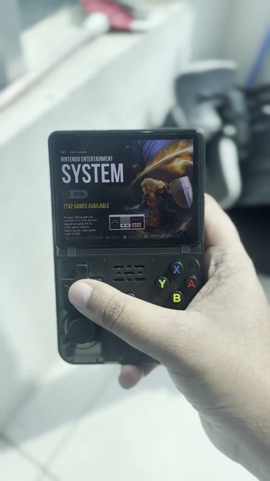

# FakeR36S-OS

**Custom firmware for fake / clone R36S handhelds built on the GA36-MB board (Allwinner A23).**
A fast, clean, ArkOS-style OS: EmulationStation, RetroArch, N64, auto-scaling, live system dashboard.

> Bought an "R36S" and it turned out to be a fake? If the back of the board says **GA36-MB** and the
> chip is an **Allwinner A23/A33** (often laser-marked "RK3326"), ArkOS, dArkOS, ArkOS4Clone and ROCKNIX
> **cannot** run on it, because they need a real Rockchip RK3326. This OS is built for that board.

## See it running

<p align="center">
  <a href="https://youtube.com/shorts/fhvOIFSZ6Z4">
    
  </a>
</p>

<p align="center">
EmulationStation, the system dashboard, and <b>Ocarina of Time running natively at around 40 FPS</b><br>
through <a href="https://github.com/Eeman1113/FakeR36S-Ocarina">FakeR36S-Ocarina</a>
(Ship of Harkinian, a native port, not an emulator).<br>
<a href="https://youtube.com/shorts/fhvOIFSZ6Z4">Watch the video</a>
</p>

## Features
- **ArkOS-style frontend**: EmulationStation (fcamod, the ArkOS fork), EPIC-CODY theme, boots straight into it
- **43 systems, best core preselected for the A23**: NES, SNES, **N64** (ParaLLEl, dynarec), GB/GBC/GBA,
  Mega Drive/32X/Sega CD, Master System, Game Gear, PC Engine/CD, SuperGrafx, PS1, PSP, CPS1/2/3, Neo Geo,
  MAME 2003-Plus, Neo Geo Pocket, WonderSwan, Atari 2600/7800/Lynx, Virtual Boy, Vectrex, MSX, ZX Spectrum,
  Amstrad CPC, Intellivision, ColecoVision, Odyssey 2, Pokemon Mini, Game & Watch, DOS
- **Automatic scaling per system**: integer scaling for Game Boy / Game Gear / Lynx / NGP, crisp
  "sharp" scaling (2x nearest + bilinear fit, FP16-safe on the Mali-400) for 2D consoles and arcade,
  smooth scaling for 3D systems
- **ArkOS hotkeys**: Select+Start exit, Select+X menu, Select+B FPS counter, Select+R1/L1 save/load state, Select+R2 fast forward
- **CPU frequency scaling** from the board's own stock DVFS table (648-1008 MHz), plus an opt-in
  **1.2 GHz performance mode** (the vendor's own max_freq)
- **System Dashboard**: live CPU per core, frequency, battery voltage/current/charge, memory, zram,
  storage, temperature, with graphs
- **No headphone pops or volume spikes**: the codec stays powered, and speaker / headphones keep
  separate volumes with a fade-in on switch
- **Automatic battery saver**: 8/16-bit systems run with the CPU capped at 816 MHz (full speed there, less power);
  heavier systems get the full clock. Switch it off in the System Dashboard
- Animated boot splash with chime, quiet boot, custom boot logo

## Supported hardware
| Board | SoC | Screen | Status |
|---|---|---|---|
| GA36-MB V1.2-20260416 "A23 Esisla" | Allwinner A23 (2 cores) | panel 2 | ✅ tested |
| other GA36-MB A23 variants (Xeno, Underscore, Elgom) | A23 | panel 1 or 2 | should work (untested) |
| GA36-MB A33 variants | A33 (4 cores) | - | use upstream goodluckOS |

Check your board: open the back, or look at **System Information → CPU NUMBER** on the stock firmware
(2 = A23, 4 = A33). The image builder refuses to run on a stock card that is not a known A23 board.

## Install

### 1. Back up your original SD card (`stock_backup.img`)
The stock card holds the vendor bootloader and your board's hardware config. **Without it this device
cannot boot anything**, so back it up first and keep the original card untouched.
The image builder only needs the first 128 MB, but a full backup also saves your games and saves.

<details open>
<summary><b>macOS</b></summary>

1. Insert the stock card and find it (check the size matches the card):
   ```
   diskutil list external physical
   ```
   It shows up as `/dev/diskN`, for example `/dev/disk4  *15.9 GB`.
2. Back it up (use `rdiskN`, it is much faster; this only **reads** the card):
   ```
   sudo dd if=/dev/rdiskN of=stock_backup.img bs=4m status=progress
   sudo chown $(whoami) stock_backup.img
   ```
   A 16 GB card takes about 15 minutes over USB 2.0.
3. Optional, quicker: only the part the builder needs:
   ```
   sudo dd if=/dev/rdiskN of=stock_backup.img bs=1m count=128
   ```
</details>

<details>
<summary><b>Linux</b></summary>

1. Find the card: `lsblk` (for example `/dev/sdb` or `/dev/mmcblk0`; check the size).
2. Back it up:
   ```
   sudo dd if=/dev/sdX of=stock_backup.img bs=4M status=progress conv=fsync
   sudo chown $USER stock_backup.img
   ```
</details>

<details>
<summary><b>Windows</b></summary>

Use **Win32 Disk Imager** (or HDD Raw Copy Tool): pick the card's drive letter, type a file name ending in
`stock_backup.img`, and click **Read** (not Write). If Windows offers to format the card, click **Cancel**:
its partitions are Linux ones that Windows can't read, and formatting would erase the bootloader.
</details>

**Verify the backup.** These two hashes should be identical for a full backup:
```
shasum -a 256 stock_backup.img
sudo dd if=/dev/rdiskN bs=4m | shasum -a 256        # Linux: sha256sum and /dev/sdX
```
Keep `stock_backup.img` somewhere safe (external drive or cloud). To restore stock at any time:
```
sudo dd if=stock_backup.img of=/dev/rdiskN bs=4m
```

### 2. Download FakeR36S-OS
Get `FakeR36S-OS_base_a23_panel2` (`goodluck_base_a23_panel2.img.xz`) from the latest
[Actions run](../../actions) or Release.

### 3. Build your flashable image
This copies your own card's boot region, adds the boot logo, and refuses to run if the backup isn't a
supported A23 board:
```
tools/make-flashable.sh goodluck_base_a23_panel2.img.xz stock_backup.img fakers36s.img
```
Needs `python3`, `xz` and `mtools` (`brew install mtools` / `apt install mtools`).

### 4. Flash a NEW microSD card
```
sudo dd if=fakers36s.img of=/dev/rdiskN bs=4m      # make sure N is the NEW card!
```
Put it in slot **TF1** and power on. The first boot grows the HOME partition to fill the card.

### 5. Add your games
**No BIOS files or games are included, and none ever will be.** Use your own legally obtained BIOS dumps
and games.

Plug the card into your computer: the **HOME** partition mounts normally. Put ROMs in `roms/<system>/`
(folder names match the stock card: `nes`, `snes`, `gba`, `n64`, `psx`, `megadrive`, ...) and BIOS files in
`.config/retroarch/system/`. Game saves (`.srm`) go next to the ROMs, as on the stock firmware.

## Ports

Native PC games rebuilt for this handheld show up in EmulationStation under **Ports**. FakeR36S-OS uses the same layout as goodluckOS, so ports from [ga36-ports](https://github.com/rincewindcz/ga36-ports) (published at [ga36.genserek.net](https://ga36.genserek.net)) work as they are: unzip a port into the root of the HOME partition and it appears in Ports with its name, description and icon on the next start of EmulationStation. You can also drop your own `.sh` launchers into `roms/ports`. Ports run at full CPU speed and log to `.config/fakers36s/port.log`.

## Updating (keeps your games and saves)

Already running FakeR36S-OS? Don't reflash. Update instead, and everything of yours stays: games, saves and save states, RetroArch and per-core settings, button remaps, themes, box art, BIOS and ports.

1. Open the [web installer](https://eeman1113.github.io/FakeR36S-OS/) and use **Already running FakeR36S-OS? Update instead** (Chrome or Edge). It puts the update package (`fakers36s-update-a23_panel2.tar`, from [Releases](https://github.com/Eeman1113/FakeR36S-OS/releases/latest)) on the card's HOME drive. Any browser works too: make a folder named `update` in the root of HOME and copy the package into it.
2. Put the card back in the console and power on. Your logo stays up with an **Updating** progress bar while it installs (a few minutes), then it restarts into the new version.

How it stays safe:
- It checks the package was made for this board and verifies every part's checksum before writing anything.
- It replaces only the system and the kernel, plus the few HOME files the OS owns (the launcher, Tools, `es_systems.cfg`), keeping the old copy as `.bak`. New defaults are only added where you have nothing, and new RetroArch settings are appended without changing yours.
- It won't start below 20% battery without a charger, and the package is deleted only after a full install: if the power goes mid-update, the next boot picks it up again.
- Every step is logged to `HOME/.config/fakers36s/update.log`.

On macOS or Linux you can also write a new flashable image's system straight to the card with `sudo tools/update-os.sh fakers36s.img <disk>`; it refuses any disk without FakeR36S-OS's partition layout and never touches HOME.

## Reading books (KOReader)

**Options > Reader** opens [KOReader](https://github.com/koreader/koreader) on a cover dashboard of everything in the `read` folder on the card: EPUB, PDF, MOBI, AZW3, FB2, CBZ, DjVu, TXT and more. Copy books into `read/` (folders are fine).

- **Buttons:** D-pad to move, A to open, Start for the menu, Y for the context menu. In a book: D-pad left / right or L1 / R1 turn pages, B goes back to the library.
- **Bookmarks:** **Select+R1** bookmarks the page you're on (again to remove it), **Select+L1** opens your bookmarks; pick one with A to jump there.
- **Select+Start** closes the reader and keeps your place.
- **Dark mode:** KOReader's top menu has **Night mode**.
- **Fonts:** any font you copy to `.local/share/fonts` on the card shows up in KOReader's font menu (FakeR36S-OS sets a reading font called Bookerly as the default, if it's there). No fonts are included beyond KOReader's own (its Chinese, Japanese, Korean, Arabic and Indic fonts are left out to keep it light, so those scripts show as boxes).
- Settings, highlights and reading positions live on the card in `.config/koreader`, so OS updates keep them. The reader runs at full CPU speed (turbo on) while it's open, and only its offline plugins are included, so it opens in a few seconds and stays smooth on 512 MB.

## Box art and menu music

The handheld has no WiFi, so box art is fetched from your computer while the card is plugged in. The easiest way is step 5 of the [web installer](https://eeman1113.github.io/FakeR36S-OS/) (Chrome or Edge): pick the card's HOME drive and it does the rest in your browser. Or use the script:

```sh
python3 tools/fetch-art.py /Volumes/HOME        # macOS
python3 tools/fetch-art.py /media/$USER/HOME    # Linux
```

It matches every ROM on the card against the free [libretro thumbnail library](https://thumbnails.libretro.com), saves 320px box art next to your games and adds it to EmulationStation's gamelists. Games that already have art (for example gamelists and images copied from your old card) are left alone. Use `--system gba` for one console or `--dry-run` to preview.

For menu music, drop `.mp3` or `.ogg` files into `roms/bgmusic` on the card. The EPIC-CODY theme's per-system sounds are built in.

## Building
GitHub Actions builds everything (kernel, Buildroot rootfs, home, base image) on every push to `main`.
See [BUILD.md](BUILD.md) to build locally with Docker.

## Credits and thanks

FakeR36S-OS stands on the shoulders of people who did the hard work first. Huge thanks to all of them.

### The foundation
- **[goodluckOS](https://github.com/CodeZombie/goodluckOS)** by **CodeZombie** and contributors (GPL-2.0).
  The project that made Linux run on the GA36-MB at all: the A23 and A33 device trees, the reverse-engineered
  JD9366 panel driver (both panels), the GA36-MB gamepad and analog-stick driver, audio, USB, power, the
  appd supervisor, the Buildroot setup and the Firmware Builder idea of reusing the stock boot region.
  FakeR36S-OS is a fork of goodluckOS. If this OS helps you, go star theirs.
- **[Debianator](https://github.com/Bepok/Debianator)** by **Bepok** (GPL-2.0).
  The N64 research and recipe (ParaLLEl N64 with gln64 on the Mali-400), the EmulationStation fcamod build
  and its five patches for this hardware, plus the pins and tuned core options used here.

### The software we package
- **[EmulationStation fcamod](https://github.com/christianhaitian/EmulationStation-fcamod)** and
  **[ArkOS](https://github.com/christianhaitian/arkos)** by **christianhaitian**: the frontend, and the OS whose
  look and feel FakeR36S-OS aims for.
- **[libretro-thumbnails](https://github.com/libretro-thumbnails/libretro-thumbnails)** and its contributors, for the box art library `tools/fetch-art.py` downloads from.
- **[ga36-ports](https://github.com/rincewindcz/ga36-ports)** by rincewindcz, the native game ports for GA36-MB handhelds that the Ports system is built around.
- **[KOReader](https://github.com/koreader/koreader)** and its contributors, the reader behind Options > Reader (AGPL-3.0, from its official armhf release, with the system SDL3, the cover grid as first view, a gamepad button map for the handheld, and fewer fonts and plugins; the changes are in `rootfs/package/koreader/koreader.mk`).
- **[RetroArch](https://github.com/libretro/RetroArch)** and the **[libretro](https://www.libretro.com)** team,
  plus the authors of every core: FCEUmm, Nestopia, Snes9x 2005 / 2010, ParaLLEl N64, Gambatte, gpSP, mGBA,
  PicoDrive, Genesis Plus GX, Beetle (Mednafen) PCE / SuperGrafx / NeoPop / WonderSwan / VB, PCSX ReARMed,
  PPSSPP, FinalBurn Neo, MAME 2003-Plus, Stella 2014, ProSystem, Handy, PokeMini, VecX, O2EM, Fuse, blueMSX,
  Game & Watch, FreeIntv, Caprice32, DOSBox and QuickNES.
- **[EPIC-CODY](https://github.com/CodyV59/es-theme-epic-cody-RG351V)** by **CodyV59**, a fork of **EpicNoir** by
  **Chicuelo** and **Nick L (c64-dev)**: the default theme, shipped unmodified (CC BY-NC-SA 4.0, non-commercial).
  All artwork belongs to its original artists.
- **[es-theme-carbon](https://github.com/RetroPie/es-theme-carbon)** by the **RetroPie** project (CC BY-NC-SA), the fallback theme.
- **[Buildroot](https://buildroot.org)**, the **[Linux kernel](https://kernel.org)** and the
  **[linux-sunxi](https://linux-sunxi.org)** community for mainline Allwinner support.
- **[Mesa](https://mesa3d.org)** and its **Lima** driver for the Mali-400 GPU.
- **[SDL](https://libsdl.org)** and **[Dear ImGui](https://github.com/ocornut/imgui)** (Omar Cornut), which the
  dashboard and the boot splash are built with.
- **[Batocera](https://github.com/batocera-linux/batocera.linux)**: the Buildroot recipe and patches for the
  FreeImage library that EmulationStation needs.
- **[Inter](https://rsms.me/inter/)** by Rasmus Andersson (OFL), the UI font.

### The detectives
Thanks to the people who took these fakes apart and wrote down what they found:
**phaseloop**, **vaboston**, **Moi-x**, **madeiragab**, **ricardomm7** (ga36-bsp), **douglaspands**, the
**[handhelds.wiki](https://handhelds.wiki/R36S_Clones)** editors, and everyone in the R36S community who
shared stock card dumps and photos.

### FakeR36S-OS
Made by **Eeman1113** (EemanSleepDeeprived): the A23 Esisla tuning, CPU frequency table, automatic scaling,
dashboard, boot splash and chime, headphone fix, systems and migration tools.

Licensed **GPL-2.0**, like goodluckOS. Third-party components keep their own licenses.

<sub>Keywords: fake R36S, R36S clone, GA36, GA36-MB, Allwinner A23, Allwinner A33, R36S custom firmware,
ArkOS alternative, R36S fake fix, EmuELEC clone, retro handheld.</sub>
